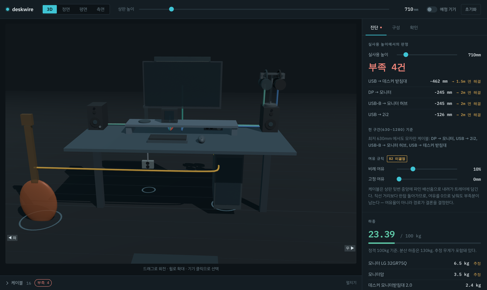

# deskwire

모션데스크 셋업 플래너. 책상이 630~1280mm를 오르내릴 때
**케이블이 닿는지** 와 **기기가 어디에 놓이는지** 를 같이 본다.



## 왜 만들었나

기기가 늘어나면서 두 문제가 동시에 생겼다.

- **신호 경로** — 어떤 포트에서 어떤 포트로 가야 원하는 소리가 원하는 데서 나는가
- **물리 배치** — 상판과 함께 움직이는 기기와 바닥에 고정된 기기 사이에서,
  가장 짧은 케이블 하나가 책상 전체의 상승 한계를 결정한다

## 하는 일

- 3D + 3뷰(정면·평면·측면)로 배치를 보고, 기기를 드래그해 옮긴다
- 상판 높이를 움직이면 케이블 길이가 실시간으로 다시 계산된다
- 케이블이 **상판 뒷변 배선홈 → 배선트레이** 로 실제로 돌아가는 경로를 잡고,
  다른 기기를 뚫지 않는 통로를 고른다
- 길이가 모자라면 **얼마나 모자란지** 와 **어느 규격을 사면 되는지** 를 알려준다
- 상판 위 하중 합계, 시나리오별 배선 필터, 아직 확인 못 한 항목 체크리스트

## 실행

```bash
npm install
npm run dev      # 개발 서버
npm test         # 모델 계층 테스트
npm run build    # 프로덕션 빌드
```

## 구조

```
data.json       기기 치수·포트·케이블·시나리오 (실측/조사 결과)
src/model/      React 비의존 순수 계산 — 2D·3D가 같은 걸 쓴다
src/views/      SceneView(2D 3뷰), Scene3D(Three.js)
src/panels/     진단 · 하중 · 시나리오 · 기기 · 확인 항목
```

`model/` 이 React에 의존하지 않는 덕분에 2D와 3D가 같은 좌표·같은 경로를 쓴다.
화면에 그려진 선과 표에 적힌 길이가 어긋나지 않는다.

데이터에서 높이는 절대값이 아니라 **관계**로 적는다
(`mount: 'desktop' | 'floor' | { on: 기기id }`). 상판 높이 하나만 바꾸면 전부 따라 움직인다.
`verified: false` 인 값은 추정치이고, 화면에 "추정" 배지로 드러낸다.

## 배포

Vercel이 저장소를 그대로 읽어간다. `vercel.json` 에 빌드 설정이 있어 Import 후 만질 것이 없다.
[vercel.com/new](https://vercel.com/new) → Import Git Repository → Deploy.

## 더 보기

- [`SPEC.md`](./SPEC.md) — 설계 결정과 기능 범위
- [`docs/QUESTIONS.md`](./docs/QUESTIONS.md) — 확인 요청 목록과 답변 상태
- [`docs/PRE-WORK-CHECKLIST.md`](./docs/PRE-WORK-CHECKLIST.md) — 착수 전 점검 결과
